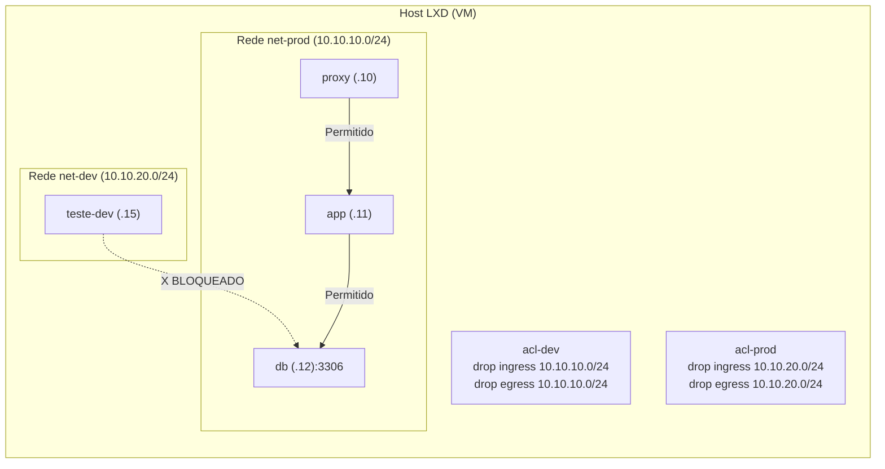

# Fase 4 · Isolamento de Redes e Exposição Controlada

Este documento registra a implementação, automação e validação da **Fase 4** do Projeto Final de Cloud Computing (UNINASSAU), focado na infraestrutura de nuvem privada com LXD/Incus na **Trilha A (WordPress)**.

---

## 1. Objetivos da Fase 4

1. **Garantir a exposição mínima necessária**: apenas o container `proxy` deve receber tráfego vindo de fora da VM (portas 8081 para HTTP e 8444 para HTTPS).
2. **Proteger o banco de dados**: demonstrar e garantir que o MariaDB (`db`, IP `10.10.10.12`, porta 3306) **não** é acessível diretamente fora do host nem a partir de ambientes não autorizados.
3. **Isolar Desenvolvimento e Produção**: comprovar que instâncias em `net-dev` (`10.10.20.0/24`) não conseguem se comunicar com as instâncias em `net-prod` (`10.10.10.0/24`), e vice-versa.
4. **Preservar a conectividade legítima**: garantir que as instâncias continuem com saída para a internet (NAT) e que o proxy reverso continue roteando requisições internas para a aplicação (`10.10.10.11:80`).
5. **Diferenciar o plano de gerenciamento (LXD) do serviço**: delimitar o papel da porta 8443 (API/UI do LXD) em relação às portas de serviço da aplicação (8081/8444).

---

## 2. Diagnóstico: O Problema do Roteamento Inter-Bridge

### 2.1 Por que duas bridges não são isoladas por padrão?

No Linux, ao criar duas bridges virtuais no mesmo host (`net-prod` em `10.10.10.1/24` e `net-dev` em `10.10.20.1/24`), o kernel do host atua como roteador entre ambas. Como o encaminhamento IPv4 (`net.ipv4.ip_forward = 1`) fica habilitado para prover saída NAT à internet para os containers, os pacotes trafegam livremente entre as bridges através da tabela de roteamento local do host.

### 2.2 Demonstração da Vulnerabilidade (Fase 4.2)

Ao subir uma instância temporária de teste na rede `net-dev` e executar uma tentativa de conexão TCP contra a porta 3306 do banco de produção (`10.10.10.12`), o resultado obtido é:

```bash
$ lxc exec teste-dev -- bash -c 'timeout 3 bash -c "echo > /dev/tcp/10.10.10.12/3306" && echo ALCANCOU || echo BLOQUEADO'
ALCANCOU
```

Isso comprova a necessidade de aplicação de regras de firewall de camada de rede (**LXD Network ACLs**) para impor o isolamento.

---

## 3. Arquitetura das ACLs no LXD

O LXD fornece suporte nativo a Network ACLs (implementadas via `nftables` ou Open vSwitch no host). Foram concebidas duas ACLs espelhadas:



### 3.1 Regras de acl-prod e acl-dev

- **`acl-prod`**:
  - `ingress`: `action=drop source=10.10.20.0/24` (descarta tráfego vindo de DEV)
  - `egress`: `action=drop destination=10.10.20.0/24` (descarta tráfego enviado para DEV)
- **`acl-dev`**:
  - `ingress`: `action=drop source=10.10.10.0/24` (descarta tráfego vindo de PROD)
  - `egress`: `action=drop destination=10.10.10.0/24` (descarta tráfego enviado para PROD)

### 3.2 A Importância de `security.acls.default.*.action=allow`

> [!IMPORTANT]
> No LXD, quando uma ACL é vinculada a uma bridge de rede, o comportamento padrão para qualquer pacote que **não coincida com uma regra explícita** passa a ser **REJEITAR/DROP**.
> Se as diretivas `security.acls.default.ingress.action=allow` e `security.acls.default.egress.action=allow` não forem configuradas, as instâncias perderão imediatamente o acesso ao gateway da bridge, à resolução DNS e ao NAT de saída para a internet.

---

## 4. Arquivos de Configuração das ACLs

Os arquivos versionados residem no diretório `conf/`:

### 4.1 `conf/acl-prod.yaml`
```yaml
name: acl-prod
description: ACL para isolamento da rede net-prod contra net-dev
rules:
  - action: drop
    direction: ingress
    source: 10.10.20.0/24
    state: enabled
  - action: drop
    direction: egress
    destination: 10.10.20.0/24
    state: enabled
config: {}
used_by:
  - /1.0/networks/net-prod
```

### 4.2 `conf/acl-dev.yaml`
```yaml
name: acl-dev
description: ACL para isolamento da rede net-dev contra net-prod
rules:
  - action: drop
    direction: ingress
    source: 10.10.10.0/24
    state: enabled
  - action: drop
    direction: egress
    destination: 10.10.10.0/24
    state: enabled
config: {}
used_by:
  - /1.0/networks/net-dev
```

### 4.3 Saída de `lxc network acl show acl-prod` (Exigido pelo Roteiro)

```yaml
$ lxc network acl show acl-prod
name: acl-prod
description: ACL para isolamento da rede net-prod contra net-dev
rules:
- action: drop
  direction: ingress
  source: 10.10.20.0/24
  state: enabled
- action: drop
  direction: egress
  destination: 10.10.20.0/24
  state: enabled
config: {}
used_by:
- /1.0/networks/net-prod
```

---

## 5. Script de Automação (`scripts/fase4-acls.sh`)

O script `scripts/fase4-acls.sh` automatiza todo o ciclo de vida das ACLs com garantias de proteção para recursos existentes e validação estrita.

### 5.1 Melhorias de Segurança e Confiabilidade
1. **Proteção contra exclusão de instâncias existentes**: o script gera identificadores temporários únicos (`teste-fase4-<timestamp>-<random>`), checa previamente se o nome já existe antes de iniciar e **nunca** executa comandos `delete` cegos sobre nomes estáticos.
2. **Limpeza atômica e segura**: a rotina de exclusão só atua sobre a instância efetivamente criada pela própria execução atual.
3. **Validação estrita de testes**: as verificações obrigatórias (bloqueio do banco, saída para a internet e resposta do proxy) interrompem a execução com código de saída diferente de zero (`exit 1`) caso ocorra qualquer falha, impedindo falsos sucessos.
4. **Rollback seletivo**: a rotina de rollback só desvincula `security.acls` se a rede estiver apontando para a respectiva ACL do script, e só exclui a ACL se ela não estiver em uso por outros recursos (`used_by` vazio).

### 5.2 Modos de Execução

| Parâmetro | Finalidade |
|---|---|
| `./scripts/fase4-acls.sh --apply` | Aplica as regras de isolamento e associa às redes (padrão se omitido). |
| `./scripts/fase4-acls.sh --status` | Inspeciona ACLs, regras e configurações ativas em `net-prod` e `net-dev`. |
| `./scripts/fase4-acls.sh --dry-run` | Simula as ações sem efetuar qualquer modificação no LXD. |
| `./scripts/fase4-acls.sh --test` | Cria container de teste exclusivo em `net-dev`, valida bloqueio ao banco, testa saída internet e verifica WordPress. |
| `./scripts/fase4-acls.sh --rollback [--yes]` | Remove a associação das redes e exclui as ACLs se não estiverem em uso. |

### 5.3 Exemplo de Execução do Script

```bash
# Simular antes de aplicar
bash scripts/fase4-acls.sh --dry-run

# Aplicar as ACLs
bash scripts/fase4-acls.sh --apply

# Conferir o status
bash scripts/fase4-acls.sh --status

# Executar a bateria de testes automatizados com validação estrita
bash scripts/fase4-acls.sh --test
```

---

## 6. Comparação dos Testes: Antes x Depois das ACLs

Conforme exigido pelo Roteiro de Implementação da disciplina, a tabela abaixo sintetiza os resultados comprovando a eficácia das regras:

| Cenário de Teste | Antes das ACLs (Fase 4.2) | Depois das ACLs (Fase 4.4) | Avaliação |
|---|---|---|---|
| **Conexão TCP DEV → Banco PROD** (`10.10.10.12:3306`) | **`ALCANCOU`** | **`BLOQUEADO`** | **Conforme** (Isolamento ativo) |
| **Ping ICMP DEV → Banco PROD** (`10.10.10.12`) | 0% perda (time=0.072ms) | 100% packet loss (timeout) | **Conforme** (Pacotes descartados) |
| **Saída da Aplicação para Internet** (`deb.debian.org`) | `HTTP/2 200` | `HTTP/2 200` | **Conforme** (NAT preservado) |
| **Acesso Externo ao WordPress** (porta `8081` / `8444`) | `HTTP/1.1 200 OK` | `HTTP/1.1 200 OK` | **Conforme** (Proxy operacional) |
| **Conexão Interna Proxy → App** (`10.10.10.11`) | `HTTP/1.1 200 OK` | `HTTP/1.1 200 OK` | **Conforme** (Comunicação local mantida) |
| **Exposição Externa da Porta 3306** (Notebook) | `TcpTestSucceeded : False` | `TcpTestSucceeded : False` | **Conforme** (Banco fechado de fora) |

---

## 7. Validação de Exposição de Portas e Delimitação da Porta 8443

### 7.1 Diferenciação entre Serviço da Aplicação e Plano de Gerenciamento

É fundamental não confundir o tráfego da aplicação com o acesso administrativo ao daemon LXD:

1. **Portas do Serviço WordPress (Encaminhadas pelo Proxy Reverso)**:
   - **Porta 8081 (HTTP)**: porta do serviço web aberta pelo dispositivo `porta-http` no container `proxy`.
   - **Porta 8444 (HTTPS)**: porta do serviço web seguro com certificado TLS assinado pela CA da equipe (Fase 5), gerenciada pelo dispositivo `porta-https` no container `proxy`.
   - Ambas são as únicas portas públicas da aplicação.
2. **Porta do Banco de Dados (MariaDB)**:
   - **Porta 3306**: estritamente interna ao container `db` na sub-rede `10.10.10.0/24`. A instância `db` não possui nenhum dispositivo do tipo proxy e sua porta nunca é exposta externamente na VM ou no host.
3. **Porta de Gerenciamento do LXD (API REST / Web UI)**:
   - **Porta 8443**: pertence exclusivamente ao daemon LXD no host (`core.https_address :8443`).
   - Essa porta **não** pertence ao WordPress e **não** é evidência de HTTPS do site.
   - O acesso a ela exige autenticação mútua TLS (tokens de confiança e certificados clientes registrados via `lxc config trust add`).
   - Por segurança, caso a gestão remota não seja necessária fora da própria VM, recomenda-se restringir o endereço de bind para loopback (`127.0.0.1:8443`) ou limitá-la via firewall do sistema operacional da VM.

### 7.2 Verificação dos Dispositivos LXD
```bash
$ lxc config device list proxy
eth0
porta-http
porta-https
root

$ lxc config device list db
dados
eth0
root
```
*Comprovação: A instância `db` possui apenas dispositivos `disk` e `nic`; não há dispositivo `proxy` cadastrado.*

### 7.3 Topologias de Rede do VirtualBox e Teste do Notebook

No ambiente de laboratório, a comunicação entre o notebook do aluno e a VM `cloud-lab` pode ocorrer em duas topologias:

#### Cenário A: Adaptador Exclusivo de Hospedeiro (Host-Only) / Bridge
Nesse cenário, a VM recebe um endereço IP na mesma sub-rede do adaptador do host (por exemplo, host em `192.168.56.1` e VM em `192.168.56.101`):

```powershell
# Porta 8081 (HTTP WordPress): DEVE RESPONDER TRUE
Test-NetConnection 192.168.56.101 -Port 8081
# TcpTestSucceeded : True

# Porta 8444 (HTTPS WordPress): DEVE RESPONDER TRUE
Test-NetConnection 192.168.56.101 -Port 8444
# TcpTestSucceeded : True

# Porta 3306 (MariaDB): DEVE RESPONDER FALSE
Test-NetConnection 192.168.56.101 -Port 3306
# TcpTestSucceeded : False
```

#### Cenário B: Adaptador NAT com Redirecionamento de Portas (Port Forwarding)
Nesse cenário, a VM possui IP interno NAT (`10.0.2.15`), mas o VirtualBox redireciona as portas para a interface de loopback do hospedeiro:

```powershell
# Porta 8081 (HTTP WordPress no loopback): DEVE RESPONDER TRUE
Test-NetConnection 127.0.0.1 -Port 8081
# TcpTestSucceeded : True

# Porta 3306 (MariaDB): DEVE RESPONDER FALSE
Test-NetConnection 127.0.0.1 -Port 3306
# TcpTestSucceeded : False
```

---

## 8. Procedimento de Restauração / Rollback

O script realiza o rollback com segurança, verificando dependências e exigindo confirmação:

```bash
# Com confirmação interativa:
bash scripts/fase4-acls.sh --rollback

# Não interativo:
bash scripts/fase4-acls.sh --rollback --yes
```

Ou manualmente via comandos LXD:

```bash
# 1. Desvincular das redes (somente se vinculadas a acl-prod / acl-dev)
lxc network unset net-prod security.acls
lxc network unset net-prod security.acls.default.ingress.action
lxc network unset net-prod security.acls.default.egress.action

lxc network unset net-dev security.acls
lxc network unset net-dev security.acls.default.ingress.action
lxc network unset net-dev security.acls.default.egress.action

# 2. Excluir as ACLs (se não utilizadas por outros recursos)
lxc network acl delete acl-prod
lxc network acl delete acl-dev
```

---

## 9. Status de Validação: Local vs VM Real

- **Validações Locais Concluídas**:
  - Sintaxe de shell verificada em todos os scripts (`bash -n`).
  - Estrutura YAML dos arquivos `conf/acl-prod.yaml` e `conf/acl-dev.yaml` validada por testes unitários em `tests/test_fase4.py`.
  - Tratamento de parâmetros, geração de nomes exclusivos e proteção contra exclusão implementados e testados.
- **Validações Pendentes na VM**:
  - A aplicação real das regras de kernel (`nftables`/`OVS`) e o teste com instâncias ativas do LXD devem ser validados na VM Ubuntu 24.04 do laboratório com `bash scripts/fase4-acls.sh --test`.

---

## 10. Evidências Coletadas

Os registros de terminal completos estão organizados na pasta `docs/evidencias/fase4/`:

1. [01-estado-inicial.txt](evidencias/fase4/01-estado-inicial.txt): Estado das redes, instâncias e portas antes da alteração.
2. [02-teste-antes-acl.txt](evidencias/fase4/02-teste-antes-acl.txt): Teste demonstrando o problema de isolamento (`ALCANCOU`).
3. [03-acls-aplicadas.txt](evidencias/fase4/03-acls-aplicadas.txt): Criação das regras e saída integral de `lxc network acl show acl-prod`.
4. [04-teste-depois-acl.txt](evidencias/fase4/04-teste-depois-acl.txt): Teste confirmando o bloqueio (`BLOQUEADO`), comparação lado a lado e saída para internet.
5. [05-validacao-servico.txt](evidencias/fase4/05-validacao-servico.txt): Validação do WordPress no proxy e testes das portas externas via PowerShell e Linux.
